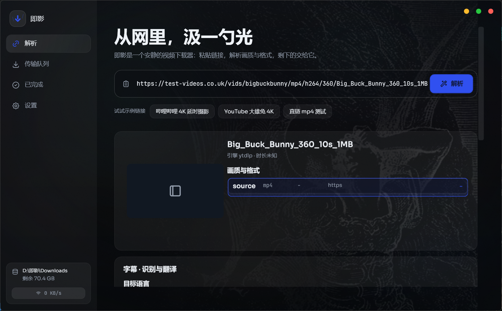
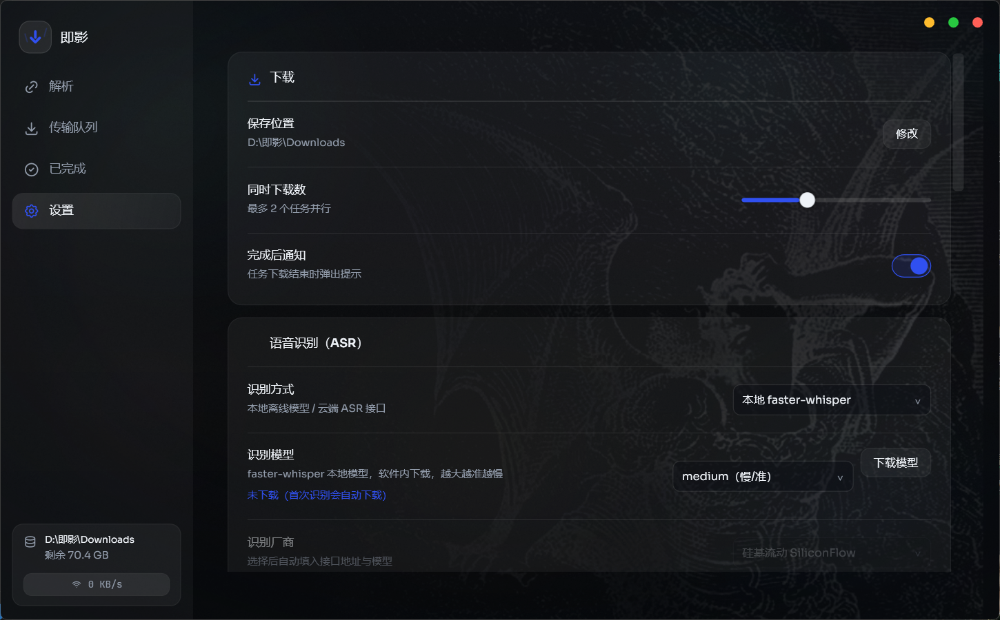

  
  <h1>即影</h1>
  
<strong>从网里，汲一勺光</strong>

  
一款安静、直接的 Windows 视频下载器，兼顾字幕识别与多语言翻译。

  

    
    
    
    
  

  

    <a href="https://github.com/Links2008/-/releases/download/v3/Jiying-Native-1.1.1.0-x64.msix"><strong>下载最新版</strong></a>
    ·
    <a href="https://github.com/Links2008/-/releases">查看更新</a>
    ·
    <a href="https://github.com/Links2008/-/issues">问题反馈</a>
  

## 功能

| 功能 | 说明 |
| --- | --- |
| 视频解析与下载 | 粘贴链接，选择画质与格式后开始任务 |
| 下载队列 | 查看进度，取消、重试并恢复未完成任务 |
| 字幕识别 | 支持本地 `faster-whisper`，也可配置云端 ASR |
| 多语言翻译 | 将识别后的字幕翻译为目标语言 |
| 本地优先 | 下载、任务记录和本地识别数据保存在你的设备上 |

## 下载与使用

1. 从 [Releases](https://github.com/Links2008/-/releases) 下载最新的 x64 MSIX 安装包。
2. 安装并启动即影，将需要处理的视频链接粘贴到解析框。
3. 选择画质、格式和字幕选项，然后开始下载。

当前版本：`1.1.1.0`  
SHA256：`123127C691A7D36C47B242E25AD4FC5504F37098958149681F787B01CB7AF114`

  
<strong>查看设置界面</strong>

   
  

## 隐私与使用说明

- 本地设置、任务记录和下载文件保存在你的设备上。
- 只有在你主动选择云端识别或翻译服务时，相关内容才会发送给对应服务商。
- 请只下载和处理你有权访问的内容。

阅读完整的[隐私政策](https://links2008.github.io/-/)，或通过 [GitHub Issues](https://github.com/Links2008/-/issues) 提交问题。

---

本仓库用于发布即影安装包、版本说明和问题反馈。
