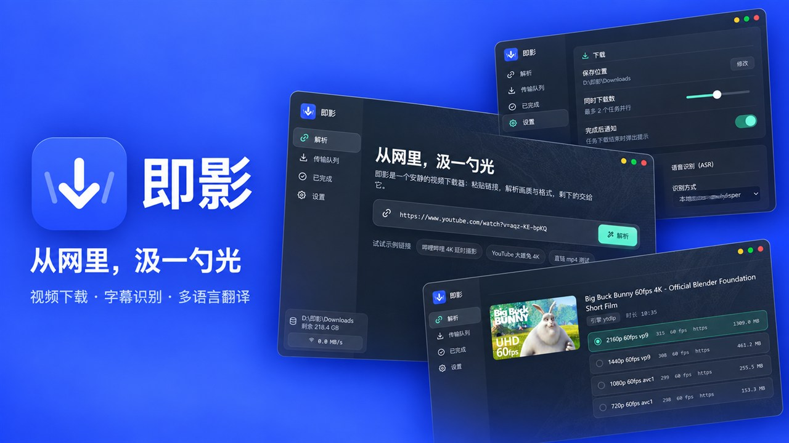
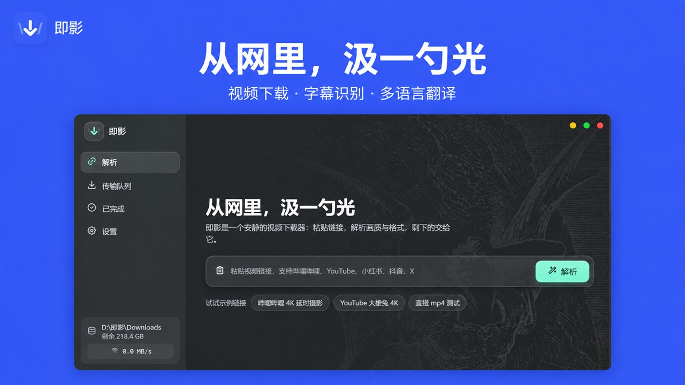
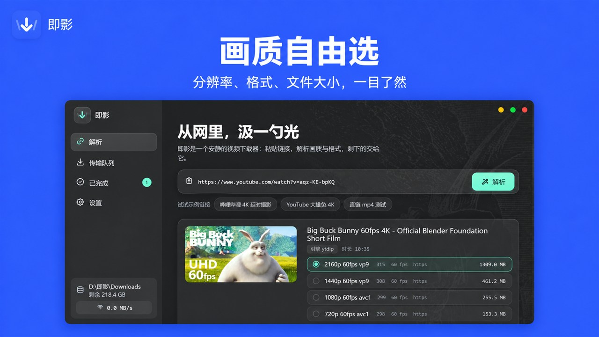
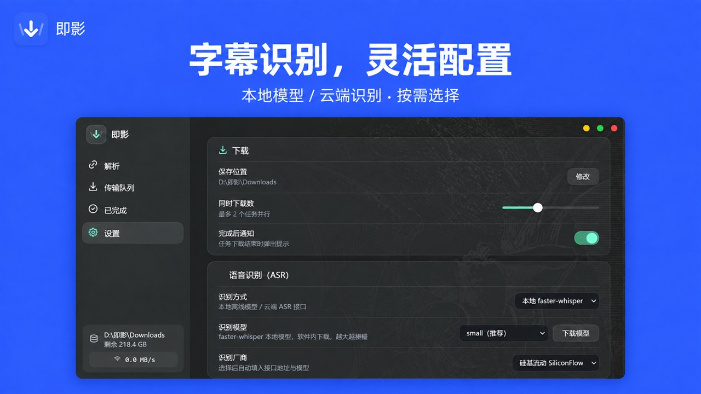

  
  <h1>即影</h1>
  
<strong>从网里，汲一勺光</strong>

  
安静、直接的 Windows 视频下载器，支持字幕识别与多语言翻译。

  

    
    
    
    
  

  

    <a href="https://github.com/Links2008/Jiying/releases/download/v1.1.10.0/Jiying-Native-1.1.10.0-x64-portable.zip"><strong>下载最新版</strong></a>
    &nbsp;|&nbsp;
    <a href="https://github.com/Links2008/Jiying/releases">版本记录</a>
    &nbsp;|&nbsp;
    <a href="https://github.com/Links2008/Jiying/issues">问题反馈</a>
  

  

## 功能

| 功能 | 说明 |
| --- | --- |
| 视频解析与下载 | 粘贴链接，选择画质和格式后开始下载 |
| 下载队列 | 查看进度，取消、重试并恢复未完成任务 |
| 字幕识别 | 支持本地 `faster-whisper`，也可配置云端 ASR |
| 多语言翻译 | 将识别后的字幕翻译为目标语言 |
| 本地优先 | 下载、任务记录和本地识别数据保存在你的设备上 |

## 界面预览

  
  

快速解析视频链接 · 清晰查看分辨率、格式和文件大小

  

按需选择本地模型或云端语音识别服务

## 下载与使用

1. 下载 [x64 便携版 ZIP](https://github.com/Links2008/Jiying/releases/download/v1.1.10.0/Jiying-Native-1.1.10.0-x64-portable.zip)，解压后运行 `Jiying.Native.exe`。
2. 启动即影，将视频链接粘贴到解析框。
3. 选择画质、格式和字幕选项，然后开始下载。

当前版本：`1.1.10.0`。便携版 SHA256：`B403DD78022E2B2C1FD7B7ABB293643D8836C32923CA139DB2DFA79E01E9D641`。

[MSIX 包](https://github.com/Links2008/Jiying/releases/download/v1.1.10.0/Jiying-Native-1.1.10.0-x64.msix)用于 Microsoft Store 提交，SHA256：`170902523F633A72934B486357C5AB9330A65B55D7C64198706977CFE87A3083`。GitHub 上的 MSIX 尚无受信任证书签名，直接安装可能出现 `0x800B010A`；商店审核通过后请从 [Microsoft Store](https://apps.microsoft.com/detail/9N2XR4X7CXPR) 安装。

## 隐私与使用说明

- 本地设置、任务记录和下载文件保存在你的设备上。
- 只有在你主动选择云端识别或翻译服务时，相关内容才会发送给对应服务商。
- 请只下载和处理你有权访问的内容。

阅读完整的[隐私政策](https://links2008.github.io/Jiying/privacy.html)，或通过 [GitHub Issues](https://github.com/Links2008/Jiying/issues) 提交问题。

---

本仓库用于发布即影安装包、版本说明和问题反馈。
